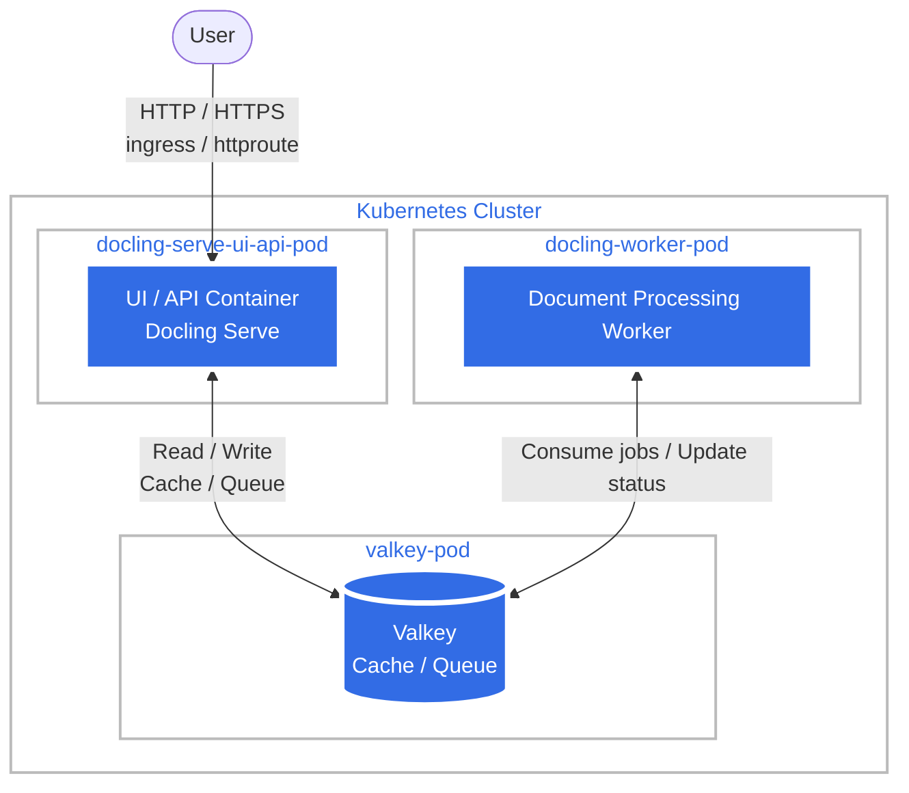

Docling is a document parsing tool, in this case deployed as a server via docling-serve.

This is by default deployed as an api + valkey + worker, to enable queues and more robust processing of documents. This also enables the UI to make it easier to experiment with.

