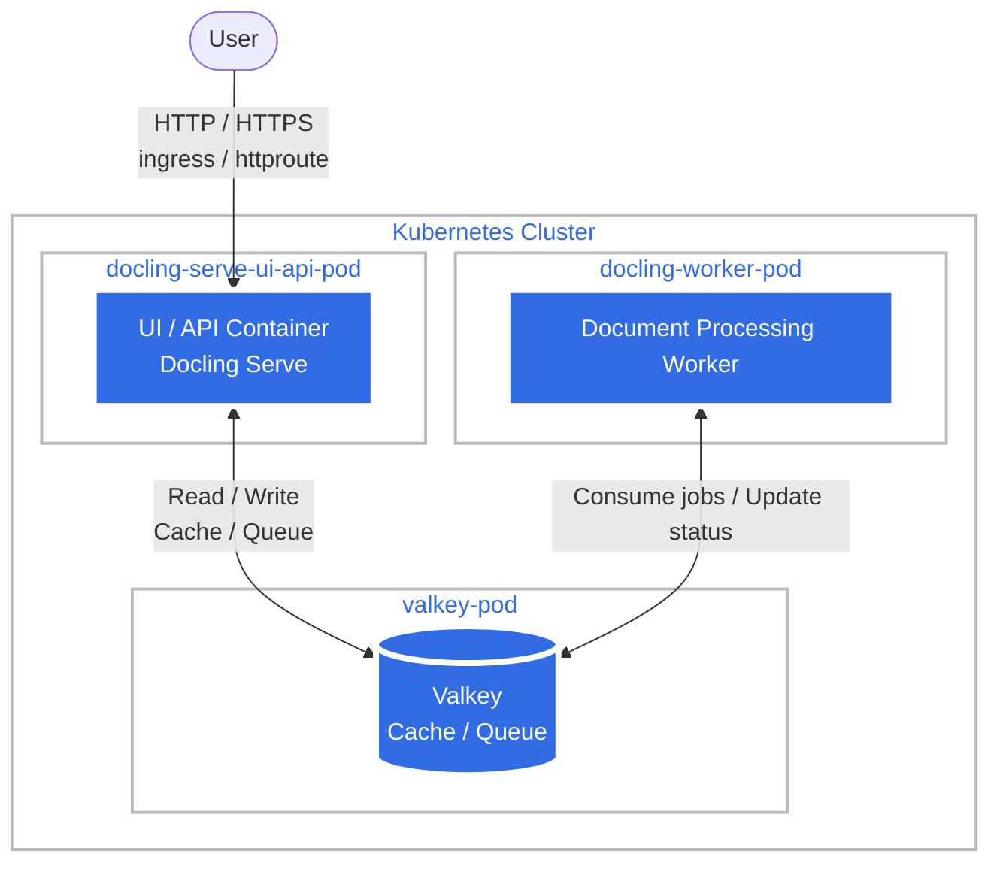

# docling

Document parsing server for gen AI applications

  

Docling is a document parsing tool, in this case deployed as a server via docling-serve.

This is by default deployed as an api + valkey + worker, to enable queues and more robust processing of documents. This also enables the UI to make it easier to experiment with.



## Installing the Chart

### Install via OCI helm registry

To install the chart with the release name `docling`, run the following commands.
For a list of all available charts and versions see the [container registry](https://gitlab.com/GeorgeRaven/raven-helm-charts/container_registry)

To pull the latest version without authentication:

```console
helm install docling oci://registry.gitlab.com/georgeraven/raven-helm-charts/docling
```

With authentication:

```console
helm registry login registry.gitlab.com -u <USERNAME> -p <GITLAB_TOKEN>
helm install docling oci://registry.gitlab.com/georgeraven/raven-helm-charts/docling --version 0.1.1
```

### As a helm dependency

You can also opt to directly reference this chart as a helm dependency defined in your `Chart.yaml`:

```yaml
dependencies:
- name: docling
  version: 0.1.1
  repository: "oci://registry.gitlab.com/georgeraven/raven-helm-charts"
  # alias: <THE_NAME_YOU_WANT_TO_GIVE_THE_CHART> # optional for more advanced use-cases
  # condition: docling.enabled # optional for more advanced use-cases
```

Then you should pull the chart with the following command:

```console
helm dependency update <PATH_TO_YOUR_CHART_DIR>
```

Which should automatically fetch the chart, update your lockfile, etc.

### Install via Helm index.yaml (deprecated method since: 2025-03-24)

To install the chart with the release name `docling`, run the following commands:

```console
$ helm repo add raven https://gitlab.com/api/v4/projects/55284972/packages/helm/stable
$ helm repo update raven
$ helm install docling raven/docling
```

## Requirements

| Repository | Name | Version |
|------------|------|---------|
| oci://registry.gitlab.com/georgeraven/raven-helm-charts | docling(corvid-app) | 0.17.0 |
| oci://registry.gitlab.com/georgeraven/raven-helm-charts | docling-worker(corvid-app) | 0.17.0 |
| oci://registry.gitlab.com/georgeraven/raven-helm-charts | valkey(corvid-app) | 0.17.0 |

## Values

| Key | Type | Default | Description |
|-----|------|---------|-------------|
| docling-worker.command[0] | string | `"sh"` |  |
| docling-worker.command[1] | string | `"-c"` |  |
| docling-worker.command[2] | string | `"docling-serve rq-worker\n"` |  |
| docling-worker.deployment.enabled | bool | `true` |  |
| docling-worker.enabled | bool | `true` |  |
| docling-worker.env[0].name | string | `"DOCLING_SERVE_ENABLE_UI"` |  |
| docling-worker.env[0].value | string | `"false"` |  |
| docling-worker.env[1].name | string | `"DOCLING_SERVE_ENG_KIND"` |  |
| docling-worker.env[1].value | string | `"rq"` |  |
| docling-worker.env[2].name | string | `"DOCLING_SERVE_ENG_RQ_REDIS_URL"` |  |
| docling-worker.env[2].value | string | `"redis://docling-valkey:6379/0"` |  |
| docling-worker.env[3].name | string | `"GRADIO_ANALYTICS_ENABLED"` |  |
| docling-worker.env[3].value | string | `"false"` |  |
| docling-worker.env[4].name | string | `"HF_HUB_DISABLE_TELEMETRY"` |  |
| docling-worker.env[4].value | string | `"1"` |  |
| docling-worker.env[5].name | string | `"HF_HUB_OFFLINE"` |  |
| docling-worker.env[5].value | string | `"1"` |  |
| docling-worker.image.registry | string | `"ghcr.io"` |  |
| docling-worker.image.repository | string | `"docling-project/docling-serve"` |  |
| docling-worker.image.tag | string | `"v1.37.0@sha256:f11cd52d4cc9251e76f7c29e929a61d24588d7c1333133edb6ca5d55b9b40899"` |  |
| docling-worker.livenessProbeEnabled | bool | `false` |  |
| docling-worker.persistence.enabled | bool | `false` |  |
| docling-worker.podSecurityContextDefault.fsGroup | int | `1001` |  |
| docling-worker.readinessProbeEnabled | bool | `false` |  |
| docling-worker.replicaCount | int | `1` |  |
| docling-worker.resourcesDefault.limits.memory | string | `"2Gi"` |  |
| docling-worker.resourcesDefault.requests.cpu | string | `"200m"` |  |
| docling-worker.securityContextDefault.allowPrivilegeEscalation | bool | `false` |  |
| docling-worker.securityContextDefault.capabilities.drop[0] | string | `"ALL"` |  |
| docling-worker.securityContextDefault.readOnlyRootFilesystem | bool | `true` |  |
| docling-worker.securityContextDefault.runAsGroup | int | `1001` |  |
| docling-worker.securityContextDefault.runAsNonRoot | bool | `true` |  |
| docling-worker.securityContextDefault.runAsUser | int | `1001` |  |
| docling-worker.service.enabled | bool | `false` |  |
| docling-worker.startupProbeEnabled | bool | `false` |  |
| docling-worker.volumeMounts[0].mountPath | string | `"/tmp"` |  |
| docling-worker.volumeMounts[0].name | string | `"tmp"` |  |
| docling-worker.volumes[0].emptyDir.sizeLimit | string | `"10Gi"` |  |
| docling-worker.volumes[0].name | string | `"tmp"` |  |
| docling.command[0] | string | `"sh"` |  |
| docling.command[1] | string | `"-c"` |  |
| docling.command[2] | string | `"docling-serve run\n"` |  |
| docling.deployment.enabled | bool | `true` |  |
| docling.enabled | bool | `true` |  |
| docling.env[0].name | string | `"DOCLING_SERVE_ENABLE_UI"` |  |
| docling.env[0].value | string | `"true"` |  |
| docling.env[1].name | string | `"DOCLING_SERVE_ENG_KIND"` |  |
| docling.env[1].value | string | `"rq"` |  |
| docling.env[2].name | string | `"DOCLING_SERVE_ENG_RQ_REDIS_URL"` |  |
| docling.env[2].value | string | `"redis://docling-valkey:6379/0"` |  |
| docling.env[3].name | string | `"DOCLING_SERVE_LOG_LEVEL"` |  |
| docling.env[3].value | string | `"WARNING"` |  |
| docling.env[4].name | string | `"GRADIO_ANALYTICS_ENABLED"` |  |
| docling.env[4].value | string | `"false"` |  |
| docling.env[5].name | string | `"HF_HUB_DISABLE_TELEMETRY"` |  |
| docling.env[5].value | string | `"1"` |  |
| docling.env[6].name | string | `"HF_HUB_OFFLINE"` |  |
| docling.env[6].value | string | `"1"` |  |
| docling.image.registry | string | `"ghcr.io"` |  |
| docling.image.repository | string | `"docling-project/docling-serve"` |  |
| docling.image.tag | string | `"v1.37.0@sha256:f11cd52d4cc9251e76f7c29e929a61d24588d7c1333133edb6ca5d55b9b40899"` |  |
| docling.livenessProbeDefault.httpGet.path | string | `"/livez"` |  |
| docling.livenessProbeDefault.httpGet.port | string | `"http"` |  |
| docling.persistence.enabled | bool | `false` |  |
| docling.podSecurityContextDefault.fsGroup | int | `1001` |  |
| docling.ports[0].appProtocol | string | `"http"` |  |
| docling.ports[0].containerPort | int | `5001` |  |
| docling.ports[0].name | string | `"http"` |  |
| docling.ports[0].servicePort | int | `80` |  |
| docling.readinessProbeDefault.httpGet.path | string | `"/readyz"` |  |
| docling.readinessProbeDefault.httpGet.port | string | `"http"` |  |
| docling.replicaCount | int | `1` |  |
| docling.resourcesDefault.limits.memory | string | `"750Mi"` |  |
| docling.resourcesDefault.requests.cpu | string | `"100m"` |  |
| docling.securityContextDefault.allowPrivilegeEscalation | bool | `false` |  |
| docling.securityContextDefault.capabilities.drop[0] | string | `"ALL"` |  |
| docling.securityContextDefault.readOnlyRootFilesystem | bool | `true` |  |
| docling.securityContextDefault.runAsGroup | int | `1001` |  |
| docling.securityContextDefault.runAsNonRoot | bool | `true` |  |
| docling.securityContextDefault.runAsUser | int | `1001` |  |
| docling.service.enabled | bool | `true` |  |
| docling.startupProbeDefault.failureThreshold | int | `10` |  |
| docling.startupProbeDefault.httpGet.path | string | `"/livez"` |  |
| docling.startupProbeDefault.httpGet.port | string | `"http"` |  |
| docling.startupProbeDefault.periodSeconds | int | `15` |  |
| docling.volumeMounts[0].mountPath | string | `"/tmp"` |  |
| docling.volumeMounts[0].name | string | `"tmp"` |  |
| docling.volumes[0].emptyDir.sizeLimit | string | `"10Gi"` |  |
| docling.volumes[0].name | string | `"tmp"` |  |
| valkey.deployment.enabled | bool | `true` |  |
| valkey.enabled | bool | `true` |  |
| valkey.image.registry | string | `"ghcr.io"` |  |
| valkey.image.repository | string | `"valkey-io/valkey"` |  |
| valkey.image.tag | string | `"9.0.6-alpine@sha256:187679e3bd4036959631e3f03983ab2ba503ab21e6fd0454d508e909db2ee989"` |  |
| valkey.livenessProbe.exec.command[0] | string | `"sh"` |  |
| valkey.livenessProbe.exec.command[1] | string | `"-c"` |  |
| valkey.livenessProbe.exec.command[2] | string | `"valkey-cli ping\n"` |  |
| valkey.persistence.enabled | bool | `true` |  |
| valkey.persistence.size | string | `"8Gi"` |  |
| valkey.ports[0].appProtocol | string | `"redis"` |  |
| valkey.ports[0].containerPort | int | `6379` |  |
| valkey.ports[0].name | string | `"redis"` |  |
| valkey.ports[0].protocol | string | `"TCP"` |  |
| valkey.ports[0].servicePort | int | `6379` |  |
| valkey.readinessProbe.exec.command[0] | string | `"sh"` |  |
| valkey.readinessProbe.exec.command[1] | string | `"-c"` |  |
| valkey.readinessProbe.exec.command[2] | string | `"valkey-cli ping\n"` |  |
| valkey.resourcesDefault.limits.memory | string | `"128Mi"` |  |
| valkey.resourcesDefault.requests.cpu | string | `"50m"` |  |
| valkey.service.enabled | bool | `true` |  |
| valkey.startupProbe.exec.command[0] | string | `"sh"` |  |
| valkey.startupProbe.exec.command[1] | string | `"-c"` |  |
| valkey.startupProbe.exec.command[2] | string | `"valkey-cli ping\n"` |  |

# Changelog

## 0.1.0 (corvid 0.17.0)

Initial release of the docling helm chart.

